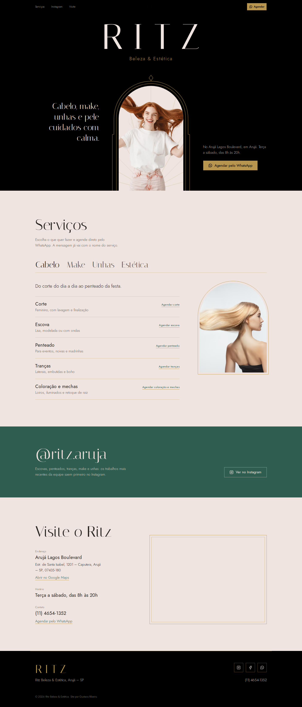
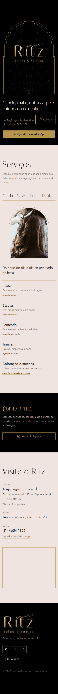

## 🚘 About the project

Website for **Ritz Beleza & Estética**, a beauty salon at Arujá Lagos Boulevard, Arujá – SP ([@ritz.aruja](https://www.instagram.com/ritz.aruja/)).

The visual direction is art déco: a stepped brass arch frames the hero, a hotel-style "carta" lists the services, and every service books directly through WhatsApp with a pre-filled message.

### Stack

- [Next.js 16](https://nextjs.org) (App Router) + React 19
- [Tailwind CSS 4](https://tailwindcss.com) + [shadcn/ui](https://ui.shadcn.com) (Radix)
- TypeScript, ESLint 9 (flat config), Prettier 3, Husky + commitlint

Salon data (phone, WhatsApp, address, hours, services) lives in `src/config/salon.ts`.

```bash
pnpm install
pnpm dev
```

### Photo credits

Photos from [Unsplash](https://unsplash.com/license) (free to use). Replace them with the salon's own photos in `src/assets/` whenever available.

- Cabelo: [Baylee Gramling](https://unsplash.com/photos/a3xr2mVjT5M)
- Make: [LOLA AZIZADA](https://unsplash.com/photos/I3y-aJ4DWng)
- Unhas: [Chelson Tamares](https://unsplash.com/photos/vtQHwU4F13s)
- Estética: [Katherine Hanlon](https://unsplash.com/photos/WAm_HaI4W2E)

## 💻 Web version
<h1 align="center">
  
</h1>

## 📱 Mobile version
<h1 align="center">
  
</h1>

## 📝 License

This project is licensed under the MIT License - see the [LICENSE](LICENSE) file for details.

Made with 💜 &nbsp;by Gustavo Henrique 👋 &nbsp;[See my linkedin](https://www.linkedin.com/in/gustavohribeiro/)
